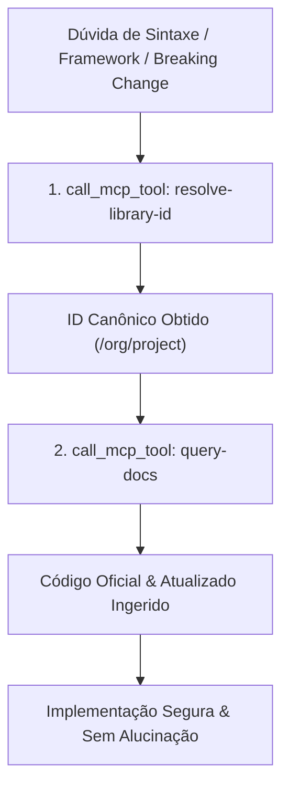

# 📚 Context7 MCP — Consulta a Documentações Oficiais em Tempo Real

> **Servidor MCP:** `context7`  
> **Modo de Carregamento:** Lazy (`call_mcp_tool`)  
> **Propósito:** Ingestão determinística e em tempo real de documentações oficiais, APIs, migrações de versão e snippets de código de bibliotecas (npm, PyPI, Go, etc.), eliminando alucinações e defasagens de dados de treinamento.

---

## 🎯 Quando Usar o Context7

O Context7 DEVE ser utilizado sempre que:
1. Trabalhar com bibliotecas e frameworks que evoluem rapidamente (ex: **React 19**, **Next.js 15 App Router**, **Tailwind CSS v4**, **Prisma v7**, **Zod**, **FastAPI**, **Pydantic v2**, **Supabase-js v2**).
2. Houver dúvida sobre breaking changes, novos hooks, migrações de sintaxe ou novas diretrizes oficiais.
3. Precisar de snippets canônicos e padrões de código verificados diretamente da fonte mantenedora.
4. **Regra de Ouro:** Preferir o Context7 sobre buscas genéricas na web (`search_web`) para consultar documentações de pacotes e ferramentas de desenvolvimento.

> [!NOTE]
> **Não usar para:** Refatoração de lógica interna do projeto, scripts ad-hoc do zero, regras de negócio próprias ou conceitos gerais de programação.

---

## 🛠️ Ferramentas Disponíveis

### 1. `resolve-library-id`
Mapeia o nome de uma biblioteca/framework para o identificador canônico do Context7 no formato `/org/project` ou `/org/project/version`.

**Parâmetros:**
- `libraryName` (string): Nome oficial da biblioteca (ex: `"Next.js"`, `"Prisma"`, `"Tailwind CSS"`).
- `query` (string): Contexto da busca para ranquear as melhores fontes e snippets.

**Exemplo de Chamada Lazy:**
```json
{
  "ServerName": "context7",
  "ToolName": "resolve-library-id",
  "Arguments": {
    "libraryName": "Next.js",
    "query": "Server Actions and form handling"
  }
}
```

---

### 2. `query-docs`
Executa consultas na base de documentação oficial associada ao `libraryId` obtido.

**Parâmetros:**
- `libraryId` (string): Identificador canônico retornado por `resolve-library-id` (ex: `"/vercel/next.js"`).
- `query` (string): Termo ou dúvida técnica específica a ser pesquisada.

**Exemplo de Chamada Lazy:**
```json
{
  "ServerName": "context7",
  "ToolName": "query-docs",
  "Arguments": {
    "libraryId": "/vercel/next.js",
    "query": "Server Actions error handling useActionState"
  }
}
```

---

## 🔄 Fluxo Canônico de Uso no Antigravity



---

## 💡 Status Operacional no Host

- **Status:** Ativo e conectado via protocolo MCP STDIO/Lazy.
- **Integração:** Citado explicitamente na diretriz global `RULE[user_global]` (Seção 5) e na matriz de ferramentas do Antigravity.
