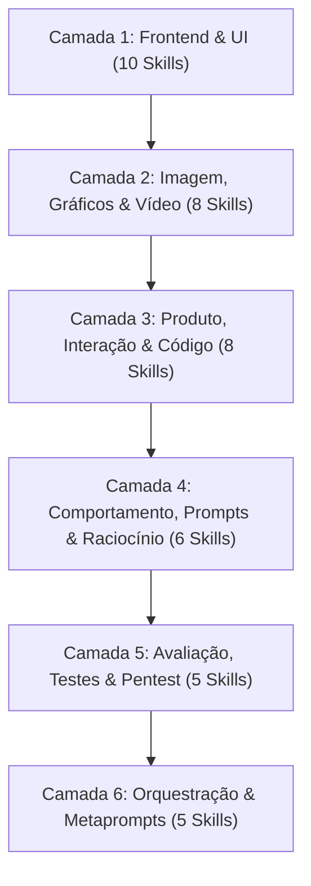

# 🛠️ Framework Canônico de 42 Skills de IA & Engenharia de Prompts (6 Camadas)

> **Segundo Cérebro — Alex Souza**  
> **Origem:** Acervo técnico do Notion (`🛠️ Framework de Habilidades de IA / Design / Sistema` + `Ferramentas e Projetos Open-Source`).  
> **Objetivo:** Eliminar a estética e o tom genérico de IA ("AI slop") e dotar o assistente de habilidades especializadas por camadas de produto.

---

## 🏛️ As 6 Camadas de Habilidades

---

### Camada 1: Frontend & UI (Design Anti-Slop)
1. **`frontend-design`**: Criação de interfaces web ricas com identidades únicas, evitando temas padrões sem personalidade.
2. **`ui-ux-pro-max`**: Inteligência e arquitetura de telas baseadas em psicologia cognitiva e fluxo de usuários.
3. **`refactoring-ui`**: Aplicação de regras de espaçamento, hierarquia tipográfica, contraste e redução de ruído visual.
4. **`top-design`**: Padrões visuais de padrão Awwwards com transições fluidas e microinterações.
5. **`web-typography`**: Emparelhamento canônico de famílias tipográficas (Display, Sans-serif, Mono).
6. **`taste-skill`**: Filtro estético anti-slop que rejeita gradientes clichês e cantos arredondados excessivos.
7. **`microinteractions`**: Efeitos de hover, active states, loaders e microfeedbacks hápticos/visuais.
8. **`ux-heuristics`**: Auditoria baseada nas 10 Heurísticas de Nielsen e nas 20 Leis de UX de Isaque Paiva.
9. **`design-html`**: Estruturação semântica limpa em HTML5 acessível (WAI-ARIA).
10. **`canvas-design`**: Composição visual programática e banners dinâmicos.

### Camada 2: Imagem, Gráficos & Vídeo
11. **`gpt-image`**: Geração precisa de imagens via prompts fotográficos detalhados.
12. **`image`**: Produção de imagens publicitárias e peças de marketing contextualizadas.
13. **`image-enhancer`**: Upscaling de resolução, realce de bordas e redução de ruído.
14. **`brand-guidelines`**: Aplicação rigorosa de identidade corporativa (logos, cores primárias, tokens).
15. **`theme-factory`**: Geração dinâmica de paletas acessíveis compatíveis com Tailwind v4 (`@theme`).
16. **`excalidraw-diagram`**: Geração de esboços técnicos e diagramas desenhados à mão.
17. **`content-studio`**: Planejamento e roteirização de carrosséis e reels de alta retenção.
18. **`video-scripting`**: Estruturação cena a cena de scripts com indicações de câmera e locução.

### Camada 3: Produto, Interação & Código
19. **`api-designer`**: Modelagem de contratos RESTful e GraphQL tipados com validação Zod.
20. **`db-architect`**: Modelagem relacional para PostgreSQL/Supabase com RLS e índices performáticos.
21. **`state-machine`**: Máquinas de estado determinísticas com XState para evitar bugs de transição na UI.
22. **`component-curator`**: Seleção de componentes do UIverse e Radix UI adaptados ao projeto.
23. **`performance-profiler`**: Otimização de Core Web Vitals (LCP < 2.5s, CLS < 0.1, INP < 200ms).
24. **`seo-mastery`**: Metatags dinâmicas, schema.org e Open Graph tags automáticas.
25. **`i18n-builder`**: Internacionalização nativa sem quebra de layout em múltiplos idiomas.
26. **`event-tracker`**: Instrumentação limpa de eventos de produto com PostHog / Plausible.

### Camada 4: Comportamento, Prompts & Raciocínio Humano
27. **`no-ai-slop`**: Remove mais de 20 manias de IA (insights forçados, dramatizações, floreios vazios).
28. **`i-have-adhd`**: Força respostas diretas, estruturadas em passos acionáveis, sem introduções prolixas.
29. **`book-to-skill`**: Transforma livros técnicos e apostilas em skills modulares consultadas por capítulo.
30. **`first-principles-thinker`**: Decomposição de problemas complexos em verdades fundamentais.
31. **`senior-code-reviewer`**: Análise crítica de pull requests priorizando manutenibilidade e segurança.
32. **`concise-executive`**: Comunicação ultra-concisa com alta densidade de informação por linha.

### Camada 5: Avaliação, Testes & Segurança
33. **`strix`**: Agente autônomo de pentest para aplicações vibe-coded que detecta vulnerabilidades reais e gera patches.
34. **`unit-test-synthesizer`**: Criação de baterias de testes unitários cobrindo casos extremos (edge cases).
35. **`a11y-auditor`**: Verificação de conformidade com WCAG 2.1 AA (contraste de cor, foco por teclado).
36. **`security-scanner`**: Varredura de injeções SQL, XSS, vazamento de credenciais e integridade de dependências.
37. **`load-tester`**: Simulação de carga e testes de estresse em APIs e conexões com banco.

### Camada 6: Orquestração & Metaprompts
38. **`agent-architect`**: Desenho de fluxos cooperativos entre múltiplos agentes especializados.
39. **`tool-caller-optimizer`**: Redução de chamadas desnecessárias de MCP e economia de latência.
40. **`context-pruner`**: Poda seletiva de histórico de conversa para manter a janela de contexto limpa.
41. **`meta-prompt-evaluator`**: Refinamento de prompts sistêmicos para máxima aderência de comportamento.
42. **`memory-consolidator`**: Consolidação periódica de aprendizados de sessão no repositório de memória.
