# 🎞️ Code Reels — vídeo como código no AGY (HyperFrames + GSAP)

Adaptação para Antigravity/Gemini da técnica mostrada por `@viniciusguimaraes.ia`
("Reel feito pelo Claude em código, sem pagar crédito de IA de vídeo"): o agente escreve a
composição em HTML, anima com GSAP e o **HyperFrames** (`github.com/heygen-com/hyperframes`,
Apache-2.0) renderiza local em MP4 via Chromium headless + FFmpeg. Custo de render: **zero**.

> [!IMPORTANT]
> Os comandos da CLI abaixo vêm da documentação pública do HyperFrames. Antes do primeiro uso,
> rode `npx hyperframes --help` e confirme flags — a ferramenta evolui rápido.

## Pré-requisitos

- Node.js 22+ (respeitar o gerenciador do repo; padrão `pnpm`/`npx`)
- FFmpeg no PATH
- Opcional: skills oficiais → `npx skills add heygen-com/hyperframes` (instala em formato Claude;
  copiar os `SKILL.md` relevantes para `~/.gemini/config/skills/` se quiser no AGY)

## Fluxo de produção

```mermaid
flowchart LR
    R["Roteiro (social-growth-agent)"] --> S["Storyboard por cena + tempos"]
    S --> C["Composição HTML/CSS (tokens da marca)"]
    C --> A["Timeline GSAP sincronizada"]
    A --> V["Voz/trilha (opcional)"]
    V --> P["npx hyperframes preview"]
    P --> L["lint/check"]
    L --> X["npx hyperframes render → MP4"]
    X --> W["video-watch: QA do próprio render"]
```



## Comandos

```powershell
npx hyperframes init meu-reel        # templates: --example kinetic-type | product-promo | cinematic-zoom
cd meu-reel
npx hyperframes preview              # studio local com timeline
npx hyperframes lint; npx hyperframes check
npx hyperframes render --output reel.mp4
```

Configurar formato vertical (1080x1920, 30fps) no projeto — confirmar a flag/config de
resolução na versão instalada (`portrait`).

## Regras de composição (o que faz o reel reter)

| Bloco | Tempo | Regra |
| :--- | :--- | :--- |
| Gancho | 0–3s | Texto grande na zona segura central, movimento já no frame 0 (nunca abrir parado) |
| Corpo | 3–35s | 1 ideia por cena, troca visual a cada 2–4s, legenda palavra a palavra com destaque de cor |
| Prova | — | Mockup de UI / terminal / número real (nunca métrica inventada) |
| CTA | últimos 5s | Palavra-chave de comentário em destaque + 3 benefícios do que a pessoa recebe |

- **Zona segura:** manter texto entre ~250px do topo e ~400px da base (UI do Instagram cobre).
- **Legendas:** sempre queimadas no vídeo; ~70% assistem sem som.
- **Marca:** usar tokens da skill do projeto (`sousza-brand-design`, `asza_media_synthesis`) —
  nada de cores soltas.
- **GSAP:** uma `gsap.timeline()` mestre, labels por cena, `ease: "power3.out"` para entradas,
  sem animações dependentes de `Date.now()`/random sem seed (render precisa ser determinístico).
- **Voz:** TTS é opcional; se usar serviço externo, chave via `.env`, nunca hardcoded.
- **Offload para Kaggle GPU (`kaggle_cloud_compute`):** Sempre que precisar gerar narração neural open-source pesada (ex: `F5-TTS`, `Kokoro-82M`, `Chatterbox`), remover fundo de vídeo/b-roll ou renderizar múltiplos Reels em lote, dispare via **`kaggle_cloud_compute`** (2x NVIDIA T4 / 32 GB VRAM gratuitas com `kaggle kernels push`) para manter a máquina local leve.

## Checklist de entrega

1. Roteiro aprovado pelo Alex **antes** de codar a composição.
2. Render final + checagem com a skill `video-watch` (frames do gancho e CTA legíveis).
3. Legenda do post via `instagram-content-engine` — e **nada é publicado sem OK explícito**.
