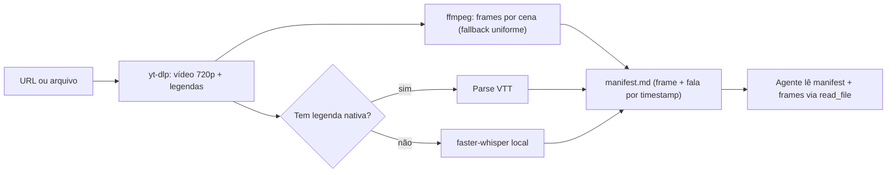

# 🎬 Video Watch — `/watch` adaptado para AGY/Gemini

Adaptação do plugin `/watch` do Claude Code (`github.com/bradautomates/claude-video`, ~19k ⭐)
para o Antigravity. Mesma ideia: o modelo não consome stream de vídeo pelo CLI, então o vídeo é
quebrado nas duas coisas que ele lê bem — **imagens (frames)** e **texto (transcrição)** — com
timestamps alinhados.

> [!NOTE]
> Implementação própria (não é cópia do repositório original). Script: `scripts/watch.py`.

## Pré-requisitos

- `uv` (dependências `yt-dlp` e `faster-whisper` são resolvidas inline pelo script)
- `ffmpeg` / `ffprobe` no PATH
- Primeira transcrição baixa o modelo Whisper (~460 MB para `small`); depois fica em cache.

## Fluxo



## Como executar

```powershell
uv run "$HOME\.gemini\config\skills\video-watch\scripts\watch.py" "<URL ou caminho>" `
  --out "<artifact-dir>\scratch\watch\<slug>" --lang pt
```

| Flag | Padrão | Uso |
| :--- | :--- | :--- |
| `--max-frames` | 40 | Teto de frames (reduza p/ vídeos longos e economizar contexto) |
| `--scene` | 0.30 | Sensibilidade de corte (menor = mais frames) |
| `--model` | small | `tiny`/`base` p/ velocidade, `medium` p/ precisão |
| `--lang` | auto | Força idioma da transcrição (`pt`, `en`) |

O script imprime o caminho do `manifest.md`.

## Protocolo do agente após rodar

1. Ler o `manifest.md` inteiro.
2. Ler os frames com `read_file` — **não todos**: priorize gancho (0–3s), viradas de cena e CTA.
   Em vídeos > 5 min, amostre no máximo ~15 frames.
3. Cruzar o que é **mostrado** com o que é **falado** (texto na tela, UI, código, b-roll).
4. Entregar no formato pedido. Para Reels, use o protocolo de engenharia reversa da skill
   `social-growth-agent` (Gancho → Retenção → Prova → CTA) e calcule a taxa de penetração
   da skill `instagram-content-engine` se houver dados de seguidores.

## Rota prioritária para vídeos longos ou em lote: Kaggle Cloud GPU (`kaggle_cloud_compute`)

> [!TIP]
> **Regra de Ouro (Zero Sobrecarga Local):** Sempre que o vídeo tiver **> 10 minutos** (aulas do IFNMG/FAT, lives, palestras do YouTube) ou quando for processar **múltiplos Reels em lote**, faça o offload para a skill **`kaggle_cloud_compute`** (30h/semana de **2x NVIDIA T4 / 32 GB VRAM** gratuitas via `kaggle kernels push`).
> Na T4 do Kaggle, o `faster-whisper` (`large-v3`, `float16`) transcreve 1 hora de vídeo em ~90 segundos + extrai os frames em paralelo sem consumir CPU/RAM local.

## Rota alternativa: Gemini API nativa

Se houver `GEMINI_API_KEY` no ambiente e o usuário aprovar envio do vídeo pra nuvem, o Gemini
entende vídeo nativamente (File API) — útil para vídeos longos. Consulte a skill `gemini-api-dev`
antes de escrever o código. Não usar com vídeos privados/sensíveis sem aval explícito.

## Limites

- Instagram/TikTok privados ou com login exigem cookies (`yt-dlp --cookies-from-browser`) — só
  com autorização do usuário.
- Saída fica em `watch-out/` ou no `--out`; limpe vídeos baixados após a análise.
