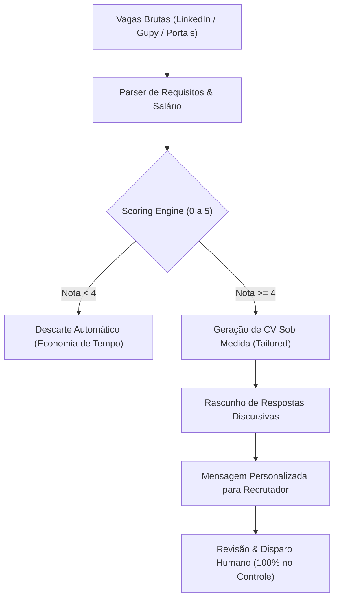

# 🧠 Social Intelligence, Career-Ops & Open Source SaaS-Killers

> **Origem:** Extração analítica profunda do acervo técnico de `@alexmsza` (Alex Souza) ⇄ `@alex.msza`.  
> **Status:** Módulo de Inteligência Canônica da Antigravity.

---

## 1. Career-Ops: Caçador Autônomo de Vagas & Scoring de Oportunidades

Inspirado no projeto open source de alta tração (+75.000 stars no GitHub) referenciado por Fabiano Carvalho (`@fabianocarvalhojr`).

### 1.1. Arquitetura Operacional

### 1.2. Heurística de Scoring (0 a 5)
* **0-2:** Desalinhamento de stack, presencialidade distante (ex: exigência física fora de Recife sem flexibilidade remota) ou senioridade fora da regra (Senior/Staff/Lead).
* **3:** Compatibilidade parcial de competências ou falta de transparência salarial.
* **4:** Forte aderência técnica (Python, SQL, Cloud, IA, Data), regime remoto ou local viável, pretensão salarial atendida.
* **5:** Compatibilidade cirúrgica com o portfólio (Governança, GenAI, Hackathons, Visão Computacional, DataSecOps).

### 1.3. Regra de Aplicação Prática
* Sempre que o usuário mencionar busca de emprego, vagas, processos seletivos ou envio de currículo:
  * Aplicar o filtro rigoroso de nota ≥ 4 antes de investir esforço de preenchimento.
  * Modular o currículo com ênfase nas palavras-chave exatas da descrição da vaga.

---

## 2. Turnitout-Humanizer: Higienização Determinística de Arquivos & Código

Baseado no repositório `AhmadHassan-BTed/Turnitout-Humanizer` (`ahmadhassan-bted.github.io/Turnitout-Humanizer/`).

### 2.1. Princípio de Funcionamento
Ao contrário de ferramentas que usam outra IA para reescrever texto (gerando alucinações e perda de precisão técnica), o Turnitout opera por **regras determinísticas**:
1. **Remoção de Caracteres Invisíveis:** Elimina caracteres zero-width (`\u200B`, `\u200C`, `\u200D`, `\uFEFF`) e marcadores invisíveis inseridos por modelos de linguagem.
2. **Sanitização de Metadados:** Limpa metadados ocultos de softwares de edição (.docx, LaTeX, PDF).
3. **Normalização de Comentários de Código:** Ajusta a densidade e o tom dos comentários em código-fonte (iniciante, pleno, sênior) mantendo a lógica executável 100% inalterada.

### 2.2. Regra de Aplicação Prática
* Em trabalhos acadêmicos (IFNMG/FAT), relatórios para clientes ou commits de código:
  * Garantir código limpo, sem caracteres invisíveis parasitas e sem comentários artificiais que pareçam gerados por automação genérica.

---

## 3. Matriz dos 8 Repositórios Open Source SaaS-Killers (Custo R$ 0)

| Categoria | Repositório Open Source | SaaS Pago que Substitui | Benefício de Engenharia & Economia |
| :--- | :--- | :--- | :--- |
| **Workspace de IA Local** | `Jan` / `Open WebUI` / `Aider` | ChatGPT Plus / Copilot ($20-$40/mês) | Roda localmente via Ollama/vLLM sem expor dados proprietários e com custo zero de token. |
| **Parsing de Documentos** | `Docling` (IBM) / `Marker` / `MarkItDown` | Adobe Acrobat / Mathpix ($15-$30/mês) | Converte PDFs escaneados, Word e apresentações em Markdown estruturado com tabelas e fórmulas intactas. |
| **Backend All-in-One** | `PocketBase` / `SurrealDB` | Firebase / Supabase Pro ($25+/mês) | Backend completo em 1 único arquivo binário (Auth, Realtime DB, S3 Storage e Admin UI) com SQLite embutido. |
| **Transcrição Offline** | `WhisperX` / `Buzz` | Otter.ai / Descript ($18-$30/mês) | Transcrição ultra-rápida de áudio/vídeo direto na máquina ou GPU com pontuação e diarização de oradores. |
| **Design & Landing Pages** | `htmlrev.com` | Webflow / Unbounce ($30-$60/mês) | Centenas de templates HTML/Tailwind responsivos prontos para produção sem lock-in. |
| **Plataforma de Estudos** | `coddy.tech` | Codecademy / LeetCode Pro ($20/mês) | Aprendizado prático de algoritmos e linguagens por níveis progressivos. |
| **Apresentações Técnicas** | `Marp` / `Slidev` | Gamma App ($15/mês) | Slides programáticos diretamente de Markdown com suporte a código e Mermaid. |
| **Automação de Conteúdo** | `Claude Instagram Skill` | Ferramentas caras de Social Media | Roteirização, análise de reels virais e moderação semi-autônoma de comunidade. |

---

## 4. Claude Instagram Skill: Engenharia Reversa de Conteúdo & Gestão de Perfil

Baseado nas implementações de Igor Henrique (`@igao.ia`):
1. **Engenharia Reversa de Reels Virais:** Analisar os ganchos (hooks de 3 segundos), a retenção intermediária e o CTA final de vídeos com alta tração técnica para transformá-los em roteiros autorais da Consultoria Sousza e dos projetos de Alex Souza.
2. **Moderação Human-in-the-Loop:** Rascunhar respostas a comentários e DMs técnicas, deixando sempre a aprovação final para Alex Souza.

---

## 5. Tríade de Engenharia de Conteúdo, Vídeo-as-Code & Análise Multimodal (AGY + Plugins Nativos + Kaggle GPU)

Integrada a partir das referências de `@marcondes.ai` (`DezlG1SsKGv`), `@viniciusguimaraes.ia` (`Deb1fwSznE2`) e `@mateus.curta.ia` (`De6kaTbxaco`), convertida nativamente para o Antigravity CLI (`agy plugin install`) e espelhada em `~/.gemini/config/skills/`:

### 5.1. Suíte dos 9 Robôs de Social Media (`sergebulaev/instagram-skills` + `instagram-content-engine`)
- **Plugin & Skills Instaladas:** `ig-hook-extractor` (10 fórmulas canônicas), `ig-caption-writer`, `ig-carousel-planner` (slide a slide), `ig-hashtag-strategist` (regra das 5 hashtags cirúrgicas), `ig-humanizer` (remoção de vícios de IA), `ig-content-planner` (calendário semanal com janelas de horário), `ig-audience-insights` (leitura real do nicho ponderando engajamento por seguidores via Apify), `ig-profile-optimizer` e `ig-repurposer`.
- **Gatekeeper Inegociável:** Aprovação humana prévia obrigatória de Alex Souza antes de qualquer publicação.

### 5.2. Reels Ilimitados em Código (`heygen-com/hyperframes` + `code-reels-hyperframes`)
- **Plugin & Skills Instaladas:** `hyperframes`, `hyperframes-cli`, `hyperframes-registry` (~450 componentes), `media-use`, `figma`, `remotion-to-hyperframes` e `slideshow`.
- **Mecanismo:** Criação de Reels verticais (`1080x1920`, 30/60fps) em HTML/CSS + GSAP Timeline renderizados localmente quadro a quadro via Chromium headless + FFmpeg (`npx hyperframes render`), com **custo zero de créditos de IA de vídeo**.

### 5.3. Olhos Multimodais para Vídeos (`bradautomates/claude-video` `/watch` + `video-watch`)
- **Plugin & Runner AGY:** Skill `watch` + `video-watch` (`scripts/watch.py` via `uv run`).
- **Mecanismo:** Baixa o vídeo (`yt-dlp`), extrai quadros-chave nas mudanças de cena (`ffmpeg` scene detection + foco nos 3 primeiros segundos de gancho), decodifica o áudio via `ffmpeg` em memória e transcreve com `faster-whisper` local, gerando um `manifest.md` sincronizado cena por cena.

### 5.4. Regra Mandatória de Offload para o Kaggle Cloud Compute (`kaggle_cloud_compute`)
- Sempre que qualquer uma dessas skills exigir processamento pesado (transcrição de vídeos > 10 min ou lotes de Reels com `Whisper Large-v3`, síntese de voz neural pesada, OCR/visão em lote com `Qwen2-VL`/`Florence-2` ou geração de embeddings), **descarregar prioritariamente para as 2x GPUs NVIDIA T4 (32 GB VRAM) gratuitas do Kaggle (`kaggle kernels push`)**, preservando 100% da CPU/RAM local.
