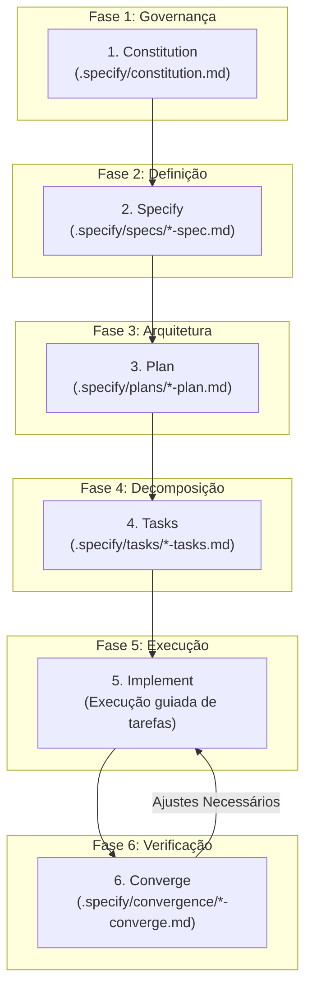
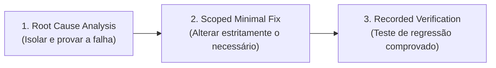

# 🌱 Spec-Driven Development (SDD) — GitHub Spec Kit Engine

> **Segundo Cérebro — Alex Souza**  
> **Origem:** Baseado no framework oficial do GitHub [github/spec-kit](https://github.com/github/spec-kit).  
> **Status:** Padrão arquitetural e de processo mandatório para **todos os projetos passados, presentes e futuros**.

---

## 🎯 Por que Spec-Driven Development?

O maior problema de desenvolvimento auxiliado por agentes de IA é o "vibe-coding" caótico: alterações sem escopo delimitado, alucinação de requisitos, falta de testes e regressões silenciosas.

O **Spec-Driven Development (SDD)** do GitHub resolve isso invertendo o fluxo:
1. **Primeiro a Especificação:** Definir com precisão matemática o que será construído, os limites de arquitetura e os critérios de aceitação.
2. **Segundo o Planejamento:** Arquitetar a solução, avaliar trade-offs técnicos e modelar dados.
3. **Terceiro as Tarefas:** Quebrar o trabalho em etapas atômicas e ordenadas por dependência de arquivos.
4. **Quarto a Convergência:** Rodar testes e verificações automatizadas até atingir `Status: Converged`.

---

## 🏛️ O Ciclo Canônico em 6 Etapas



---

## 📁 Estrutura Canônica do Diretório `.specify/`

Todo projeto auditado ou desenvolvido no ecossistema de Alex Souza deve adotar o diretório `.specify/` na raiz:

```text
.specify/
├── constitution.md          # Leis do projeto, qualidade, segurança e regras de arquitetura
├── specs/                   # Especificações funcionais e contratos de negócio
│   └── 001-nome-feature.md
├── plans/                   # Blueprints técnicos e decisões de stack
│   └── 001-nome-feature.md
├── tasks/                   # Checklists atômicos ordenados por dependência
│   └── 001-nome-feature.md
└── convergence/             # Relatórios de testes e verificação de convergência
    └── 001-nome-feature.md
```

---

## 🔧 Protocolo de Bug Fixing (Spec Kit Extension)

Para correção cirúrgica de defeitos sem necessidade do fluxo de nova feature:



1. **Causa Raiz Comprovada:** Apresentar a linha exata e a condição de falha com evidência objetiva.
2. **Correção Cirúrgica de Escopo Mínimo:** Jamais alterar lógicas paralelas ou refatorar componentes alheios ao bug.
3. **Verificação Registrada:** Criar teste unitário ou de integração que falhava antes e agora passa com sucesso.
