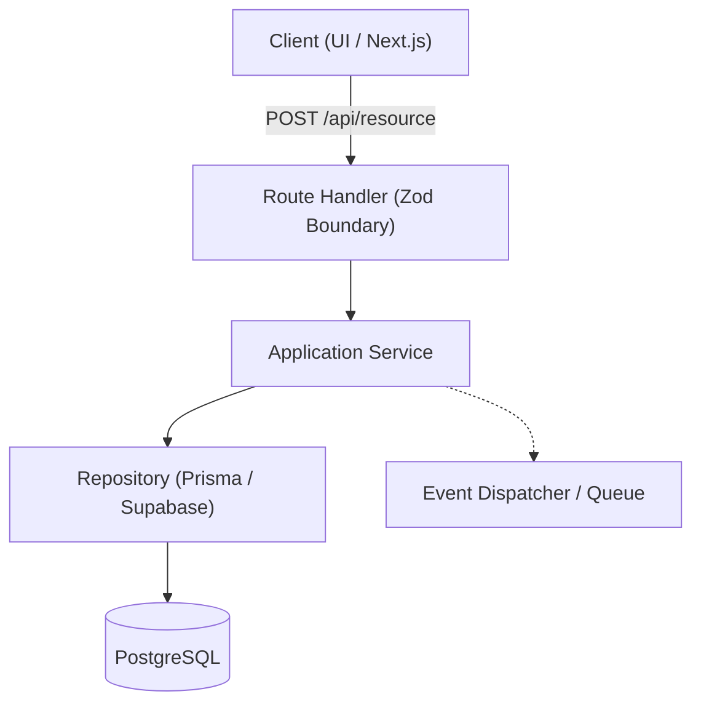

# 📐 Plano de Arquitetura: [Nome da Feature / Módulo]

> **Especificação Vinculada:** `specs/000-template-spec.md`  
> **Status:** [Draft / Approved / In Progress]

---

## 1. Visão Geral da Arquitetura & Decisões Técnicas

---

## 2. Árvore de Arquivos Afetados
- `src/app/api/v1/resource/route.ts` (Novo)
- `src/lib/services/resource.service.ts` (Novo)
- `src/lib/schemas/resource.schema.ts` (Novo)
- `src/tests/integration/resource.test.ts` (Novo)

---

## 3. Trade-offs Considerados
| Opção Avaliada | Vantagens | Desvantagens | Decisão |
| :--- | :--- | :--- | :--- |
| **Abordagem A (In-Memory)** | Simples, latência zero | Não persiste em reinicialização | Rejeitada para produção |
| **Abordagem B (PostgreSQL + RLS)** | Persistência íntegra, segurança por tenant | Requer migrations | **Aprovada (Padrão do Projeto)** |
