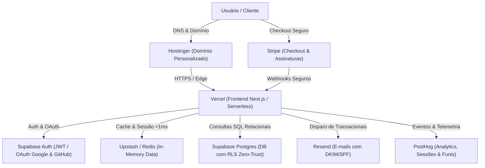

# 🏗️ Stack Canônica de MVP de Baixo Custo (Zero-Waste Architecture)

> **Segundo Cérebro — Alex Souza**  
> **Origem:** Página do Notion `Ferramentas para iniciar um projeto` (`3c9d772c-5d12-803d-af29-ebb2d45926d9`).  
> **Objetivo:** Padrão arquitetural oficial para construir e lançar novos produtos digitais com custo fixo mínimo (~$20/mês), alavancando camadas gratuitas de provedores de nível corporativo.

---

## 🏛️ Topologia da Arquitetura

---

## 📋 Detalhamento dos Componentes & Custos

| Camada | Provedor / Tecnologia | Custo Inicial | Função no Sistema |
| :--- | :--- | :--- | :--- |
| **Inteligência & Código** | Claude 3.5/3.7 | ~$20/mês | Pair programmer para geração de features, testes e refatoração rápida. |
| **Hospedagem & CI/CD** | Vercel | R$ 0 (Hobby Tier) | Deploy automático a partir do GitHub, SSR, Edge Middleware e SSL global. |
| **Banco de Dados & BaaS** | Supabase | R$ 0 (Free Tier) | PostgreSQL relacional, Row Level Security (RLS), Storage para arquivos e Auth nativo. |
| **Cache & Filas Rápidas** | Redis (Upstash) | R$ 0 (Free Tier) | Cache em memória de respostas caras, rate-limiting e filas assíncronas. |
| **E-mails Transacionais** | Resend | R$ 0 (Free Tier: 3k/mês) | Confirmações de cadastro, redefinições de senha e notificações via API tipada (`resend`). |
| **Analytics de Produto** | PostHog | R$ 0 (Free Tier: 1M eventos) | Mapas de calor, gravação de sessões, métricas de retenção e experimentos A/B. |
| **Gateway de Pagamento** | Stripe | 2.3% por venda | Checkout pré-construído, faturamento de assinaturas e suporte a cartões e Pix. |
| **Repositório de Código** | GitHub | R$ 0 | Controle de versão, GitHub Actions para testes automatizados e integração contínua. |
| **Domínio Próprio** | Hostinger / Cloudflare | ~R$ 40/ano | Domínio institucional para autoridade de marca e entrega segura de e-mails. |

---

## 🔒 Princípios de Produção Obrigatórios
1. **Zero Hardcoded Secrets:** Nenhuma chave (`NEXT_PUBLIC_`, tokens de API, segredos do Stripe) é gravada em repositório. Uso rigoroso de `.env.local` e Vercel Environment Variables.
2. **Zero Architecture Leaks:** Telas e modais nunca expõem nomes de provedores (ex: "Erro no Supabase") — apenas feedbacks acolhedores e funcionais para o usuário.
3. **Escalabilidade Sem Fricção:** Quando o produto validar tração financeira, a transição para planos pagos (Pro) ocorre sem alteração na base de código.
